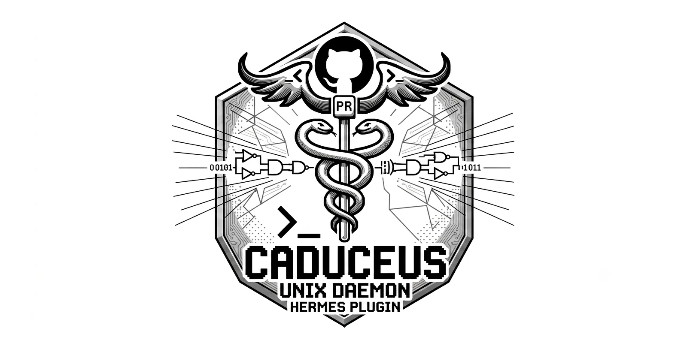

# Caduceus

<p align="center"><em>Your agent does the thinking. Caduceus does the paperwork.</em></p>

<p align="center">
  <a href="https://github.com/barkley-assistant/caduceus/releases"></a>
  <a href="LICENSE"></a>
  <a href="https://github.com/barkley-assistant/caduceus/actions/workflows/ci.yml"></a>
  <a href="https://github.com/barkley-assistant/caduceus/wiki"></a>
</p>

> A Hermes plugin that auto-reviews pull requests in an OCI sandbox and
> implements handoff tickets — without making you babysit either.

Caduceus is a Unix one-shot tick daemon (Rust binary + Hermes plugin +
operator-owned Python bridge). Cron invokes `caduceus run` about every two
minutes. Linux is tier-1; macOS is tier-2 and CI-enforced. Windows is not a
target.

**Two jobs, one binary:**

1. **Auto-review PRs** (opt-in). With `auto_review.enabled` and
   `executor_mode: oci`, each new PR head runs in an isolated sandbox.
   Result: sticky PASS/FAIL with findings. Trusted authors can comment
   `/caduceus review` to re-run the current head.
2. **Implement handoff tickets.** Label an issue `autofix`; Caduceus claims it,
   provisions a worktree, runs your harness under timeout, then commits, pushes,
   opens a PR, comments, and closes — checkpointed before each side effect.

The daemon owns polling, claims, worktrees, timeouts, Git/GitHub, and the
public-voice filter. Your worker owns “what should the code say?” They meet at
env vars and `worker-result.json`. Pull-only (no inbound HTTP). No auto-merge.
Reviews and PRs are for a human to act on.

## Install (Hermes)

Requires **Hermes Agent v0.22.x or newer**.

```bash
hermes plugins install barkley-assistant/caduceus --enable
hermes caduceus setup                 # build + seed your bridge
hermes caduceus cron-install          # 2-min no-agent job
hermes caduceus status                # verify
```

Setup builds the Rust binary into `<plugin>/bin/caduceus` and seeds
`~/.hermes/caduceus/worker-bridge.py` only if absent (template:
`plugin-assets/worker-bridge.py`). Plugin source updates do not overwrite your
bridge; setup may write a sibling `.new` candidate.

```bash
hermes plugins update caduceus        # refresh source
hermes caduceus setup                 # rebuild after update
hermes caduceus cron-remove           # before uninstall
hermes plugins remove caduceus        # state/bridge/config survive
```

## Install (standalone, no Hermes)

Same daemon; you lose the skill, slash command, and cron helpers.

```bash
git clone https://github.com/barkley-assistant/caduceus
cd caduceus
cargo build --release --locked
install -m 0755 target/release/caduceus ~/.local/bin/caduceus
# config: ~/.config/caduceus/config.yaml under `caduceus:`
# schema: https://github.com/barkley-assistant/caduceus/wiki/Configuration
```

Standalone installs **must** set `worker_command` explicitly. The Hermes plugin
has a default bridge path; you do not.

`caduceus setup` only writes a minimal non-secret config file. Build and bridge
seed are `hermes caduceus setup` (plugin path).

### Workers run sandboxed (OCI)

Auto-review **requires** OCI. Ticket workers may use TrustedHost (default) or
OCI. Sandbox config is one nested `sandbox:` block:

```yaml
executor_mode: oci
sandbox:
  engine: docker            # or podman
  image: "caduceus-worker@sha256:<64 lowercase hex>"  # required
  pull_policy: if_missing   # never | if_missing | always
  resources: { cpus: 2.0, memory_mb: 2048, pids: 256, tmpfs_mb: 256, shm_mb: 64 }
  network: none             # none | unrestricted (never host)
  pass_env: []              # exact names only; credentials refused at load
```

Baseline (not negotiable): read-only rootfs, `--cap-drop ALL`,
`no-new-privileges`, bounded resources, no host namespaces, daemon-owned
read-only `.git` shadow. `network: none` is loopback only; `unrestricted` is the
engine bridge — host networking is unrepresentable.

TrustedHost may omit `sandbox:` but needs
`reduced_containment_acknowledged: true`. `executor_mode: oci` fails load
without a digest-pinned `sandbox.image`. Check with `caduceus doctor`.

Details:
[docs/certification/oci-certification.md](docs/certification/oci-certification.md),
[wiki Configuration](https://github.com/barkley-assistant/caduceus/wiki/Configuration).

## 60-second orientation

1. Install (Hermes or standalone above).
2. Put watched repos at `<workdir_base>/<owner>/<repo>` (default
   `~/projects/<owner>/<repo>`) with a working `origin` and non-interactive git
   credentials (SSH key or credential helper). Missing clones are refused, not
   retried forever.
3. Create the ticket label (optional if you only enable auto-review):

   ```bash
   gh label create "autofix" --repo OWNER/REPO --color 7C3AED \
     --description "Triggers Caduceus code automation"
   ```

4. For PR review, set `executor_mode: oci`, a valid `sandbox:`, and
   `auto_review.enabled: true`. By default Caduceus waits for green CI
   (or no CI) before reviewing; set `require_ci_pass: false` to review
   on every push. See [docs/auto-review.md](docs/auto-review.md).
5. First real traffic: `CADUCEUS_DRY_RUN=1`. Dry-run does everything except
   commit / push / comment / label / PR / close, and writes
   `<state_dir>/runs/<run_id>.dry-run.md`.

## Keys you need

Full schema:
[wiki Configuration](https://github.com/barkley-assistant/caduceus/wiki/Configuration).
Unknown keys fail config load (`deny_unknown_fields`).

- `watched_repos` — `owner/repo` list. Each needs a local clone under
  `workdir_base/<owner>/<repo>` with a working `origin`.
- `worker_command` — argv for the worker. Hermes seeds
  `~/.hermes/caduceus/worker-bridge.py`; standalone must set this.
- `poll_interval_seconds` — minimum tick cadence (default `120`).
- `ticket_label_code` — issue label for ticket runs (default `autofix`). Legacy
  `🤖 auto-fix` translates at read time. `auto_review.enabled` turns on PR review
  (requires OCI).

## Auth: two credentials

The **GitHub API token (PAT)** is for polling, labels, comments, and PRs
(`github_token` → `CADUCEUS_GITHUB_TOKEN` → `GITHUB_TOKEN` → `gh auth token`).
**Git push** uses your SSH agent or credential helper. Configure both; do not
reuse one for the other.

## CLI

Bare `caduceus` prints help and exits 0. Cron must call `caduceus run`.

```text
caduceus run                          # one tick
caduceus status [--json]              # daemon / queue summary
caduceus doctor [...]                 # live OCI readiness
caduceus worktree-gc [...]            # sweep stale worktrees
caduceus queue <show|reset|reprocess|remove>
caduceus review <status|list|show>
caduceus migrate-state [...]          # legacy JSON / SQLite
caduceus setup [--dry-run]            # minimal non-secret config
```

Flags, exits, and `hermes caduceus` wrappers: [docs/cli.md](docs/cli.md).

## Operator manual (wiki)

- [Home](https://github.com/barkley-assistant/caduceus/wiki/Home)
- [Installation](https://github.com/barkley-assistant/caduceus/wiki/Installation)
- [Configuration](https://github.com/barkley-assistant/caduceus/wiki/Configuration)
- [Auto Review](https://github.com/barkley-assistant/caduceus/wiki/Auto-Review)
  — also [docs/auto-review.md](docs/auto-review.md)
- [The Bridge](https://github.com/barkley-assistant/caduceus/wiki/The-Bridge)
- [State Recovery](https://github.com/barkley-assistant/caduceus/wiki/State-Recovery)
- [Troubleshooting](https://github.com/barkley-assistant/caduceus/wiki/Troubleshooting)
- [FAQ](https://github.com/barkley-assistant/caduceus/wiki/FAQ)
- [Migration](https://github.com/barkley-assistant/caduceus/wiki/Migration) —
  also [docs/migration.md](docs/migration.md)
- [CLI reference](docs/cli.md) (in-repo)

Worker transcripts: `<state_dir>/runs/<run_id>.log` (stdout+stderr, capped by
`transcript_max_bytes`).

## State and recovery

**Never hand-edit** state, claims, or transcripts. Use CLI only.

- Backends: JSON (default) or SQLite via `caduceus migrate-state --to-sqlite`.
- Tickets: `queue show|reset|reprocess|remove`.
- Reviews: `review status|list|show`.
- Worktrees: `worktree-gc`.

Playbook:
[State Recovery](https://github.com/barkley-assistant/caduceus/wiki/State-Recovery).

## What it is not

- Not multi-host (one daemon per host).
- Not a GitHub App (fine-grained PAT today).
- Not a hosted service or webhook receiver (pull-only).
- Not an auto-merger; verdicts and PRs need a human.
- Not locked to one LLM — you own the bridge / `harness.py`.

## Contributing

[SemVer 2.0.0](https://semver.org/). Versioned surface: CLI, Config YAML, plugin
manifest, worker env/`worker-result.json`, state format, default
`comment_forbidden_strings`.

- [CONTRIBUTING.md](CONTRIBUTING.md) · [RELEASING.md](RELEASING.md) ·
  [CHANGELOG.md](CHANGELOG.md) · [AGENTS.md](AGENTS.md)

## License

MIT. See [LICENSE](LICENSE).
